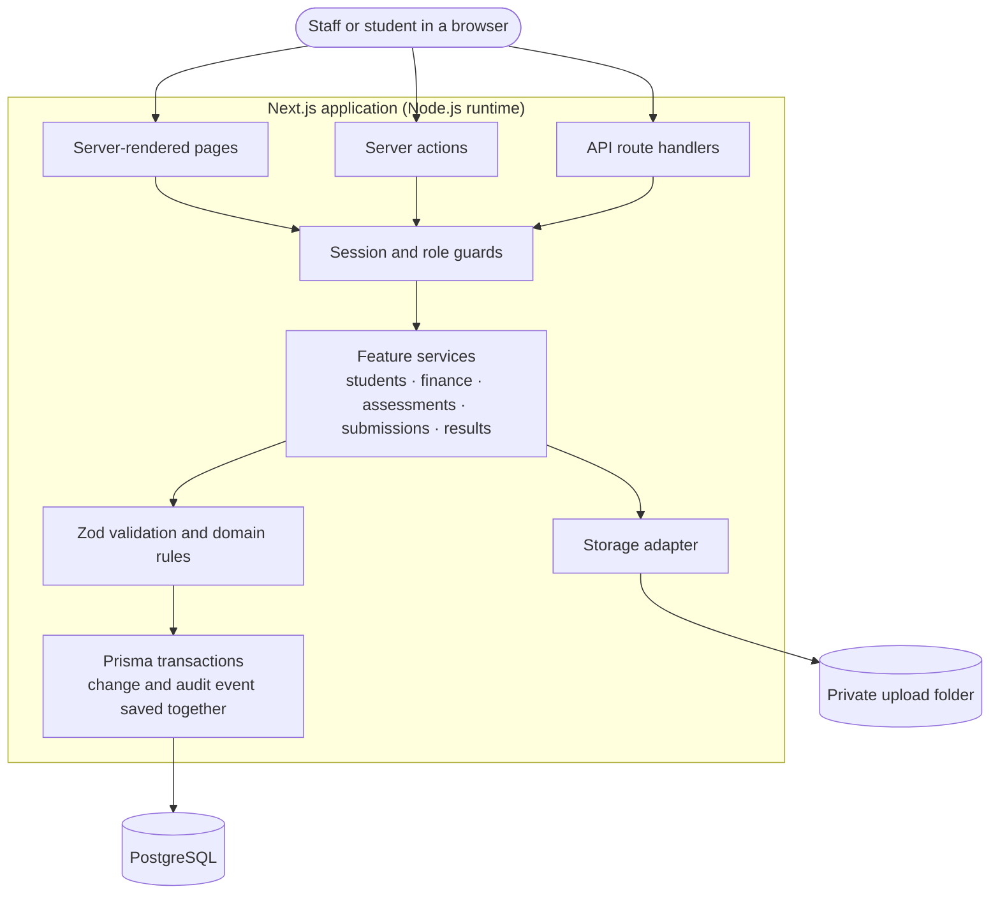
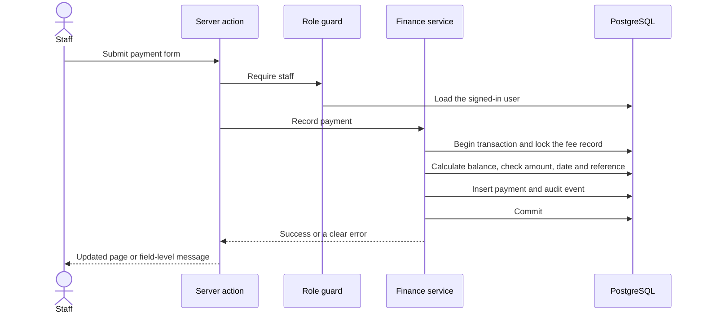
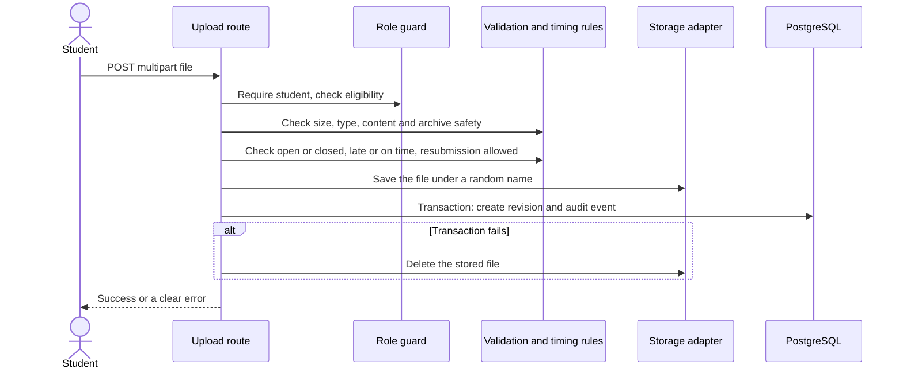
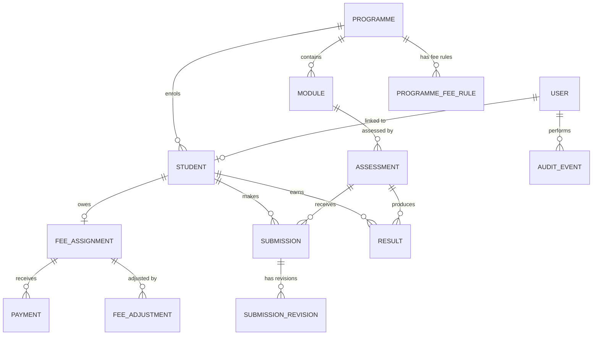

# Architecture

This document describes how the SMS Registry module is designed: what it is for, how a request moves through it, how the data is modelled, the rules it enforces, and how it is secured and tested. It is the single reference for the system. The [README](../README.md) covers setup and usage, and [DECISIONS.md](DECISIONS.md) explains why individual choices were made.

## Contents

1. [Purpose and scope](#1-purpose-and-scope)
2. [System overview](#2-system-overview)
3. [How requests flow](#3-how-requests-flow)
4. [Identity, sessions and authorization](#4-identity-sessions-and-authorization)
5. [Code organisation](#5-code-organisation)
6. [Data model](#6-data-model)
7. [Business rules](#7-business-rules)
8. [Uploads and file storage](#8-uploads-and-file-storage)
9. [Audit trail](#9-audit-trail)
10. [Money, dates and time zones](#10-money-dates-and-time-zones)
11. [API contract](#11-api-contract)
12. [User interface](#12-user-interface)
13. [Security baseline](#13-security-baseline)
14. [Configuration](#14-configuration)
15. [Demo data](#15-demo-data)
16. [Testing strategy](#16-testing-strategy)
17. [Running in production](#17-running-in-production)
18. [Known limitations and future work](#18-known-limitations-and-future-work)

## 1. Purpose and scope

The system supports the four workflows a Registry Administrator handles every day:

1. **Student enrolment**: creating and managing student records.
2. **Fees and payments**: tracking what each student owes and has paid.
3. **Assessment submissions**: staff create assessments, students submit work.
4. **Marksheet and results**: staff grade work and control when students see results.

Two kinds of user exist: **Registry staff**, who can use every workflow, and **students**, who can see only their own balance, assessments, submissions and published results.

The design aims for correctness around the awkward cases a Registry team meets in practice: students who leave owing money, work that arrives late, results that must be held back, and two people editing the same record at once.

**Deliberately out of scope:** real authentication (passwords or single sign-on), payment gateways, refunds and instalment plans, reporting, bulk imports, timetabling, attendance and parent access.

## 2. System overview



**Technology:** Next.js 16 (App Router), React 19, TypeScript in strict mode, Prisma 7 with PostgreSQL, Tailwind CSS 4, Zod, `jose` for signed sessions, and Vitest and Playwright (with axe) for testing.

**Key design ideas**

- **One place for rules.** Pages, server actions and API routes all call the same feature services, so a rule is written once and behaves identically everywhere.
- **Changes and audit records are inseparable.** Every mutation and its audit event are written in one database transaction.
- **The database backs the code.** Unique keys and CHECK constraints protect the same rules the code enforces.
- **Derived, not stored.** A student's balance is calculated from the ledger every time. There is no balance column to drift out of date.
- **Server-side authority.** The browser is never trusted to say who someone is or what they may see.

## 3. How requests flow

### Recording a payment



The lock on the student's fee record is what stops two simultaneous payments from overpaying.

### Uploading a submission



Invalid requests are rejected before anything is written. If the database write fails after the file is saved, the file is deleted, so failed uploads leave nothing behind.

## 4. Identity, sessions and authorization

### Demo accounts

Real sign-in was not required for this assessment, so identity is handled by a small, server-enforced demo mechanism.

- The home page lists two staff accounts and a limited set of student accounts. Each is a `User` with `isDemoPersona = true`. Students created through normal enrolment get a linked `User` but never appear on the home page.
- Choosing an account signs a JWT (HS256, `jose`) that carries **only the user id**, valid for eight hours, and stores it in an `httpOnly` cookie.
- On every request the guard verifies the token and then loads the user's **current** role, linked student and student status from PostgreSQL. A cookie can therefore never grant more than the database says.
- `POST /api/session` and `DELETE /api/session` exist only while `ENABLE_DEMO_SESSION=true`.
- The header always shows which account is active and offers a switch.

All of this sits behind one function, `getSession()`. Replacing the demo mechanism with real authentication means changing that function, not the rest of the system.

### Guards

| Guard | Purpose |
|---|---|
| `requireStaff()` | Staff-only pages, actions and endpoints |
| `requireStudent()` | Student-only pages and endpoints |
| `requireOwnStudent(studentId)` | A student acting on their own records |

Every page, server action and route handler calls its own guard. The `proxy.ts` file only redirects visitors who have no cookie at all; it is a convenience and is never the authorization boundary. Pages do not rely on their layout for protection, because layouts are not re-run on every client-side navigation.

Access to another student's resource returns **404**, not 403, so the response does not confirm that the record exists.

### Cookie behaviour

The cookie is `httpOnly`, `SameSite=Lax`, has path `/`, and expires after eight hours. Whether it carries the `Secure` flag is controlled by `COOKIE_SECURE`:

| Value | Behaviour |
|---|---|
| `auto` (default) | Follows the protocol of the request, using the first `X-Forwarded-Proto` value if present. Never guesses from the build mode. |
| `true` | Always `Secure`. Use behind an HTTPS proxy that does not forward protocol headers. |
| `false` | Never `Secure`. For explicit local HTTP testing only. |

Following the request, rather than the build mode, means a production build served on `http://localhost` can still sign in, while a deployment behind HTTPS automatically gets a `Secure` cookie.

## 5. Code organisation

```text
prisma/                schema, migrations, seed
scripts/               database reset, test-database helper
src/
  app/
    page.tsx           demo account picker
    staff/             staff pages
    student/           student pages
    actions/           server actions
    api/               route handlers
  features/
    students/          enrolment, status rules, search, ID generation
    finance/           balance, payments, voids, adjustments, overdue queue
    assessments/       assessments, eligibility, grading-grid membership
    submissions/       upload validation, revisions, timing rules, storage
    results/           grades, classification, publication lifecycle
  components/          shared interface components (ui/ for base primitives)
  lib/                 session, environment, errors, money, clock and formatting, storage
tests/                 integration and browser tests
```

| Layer | Responsibility | What it must not do |
|---|---|---|
| Pages and components | Present server-fetched data and accessible forms. | Hold the only copy of any data. |
| Guards | Resolve the session to a current user. | Trust a role sent by the browser. |
| Server actions and route handlers | Authorize, parse input, call a service, return a standard response. | Change data without going through validation and audit. |
| Feature services | Enforce rules, take locks, group a change with its audit event in one transaction. | Duplicate a rule differently for pages and the API. |
| Prisma and PostgreSQL | Constraints, unique keys, durable transactions, queries. | Store anything that should be derived, such as a balance. |
| Storage adapter | Save, stream and delete private files by random key. | Store files under `public/` or by original filename. |

Read-only pages may query Prisma directly for the data they display. All state changes go through server actions or services.

## 6. Data model



| Model | Purpose and key rules |
|---|---|
| `User` | Name, role (staff or student), optional link to one student, and a flag marking demo accounts. Holds no credentials. |
| `Programme`, `Module` | The catalogue. A module belongs to one programme, which is how an assessment's programme is known. |
| `ProgrammeFeeRule` | One fee amount and due date per programme and academic year (unique together). |
| `Student` | Immutable student ID, unique normalised email, date of birth, programme, academic year, status and reason. Indexed by programme, year and status. |
| `StudentIdCounter` | One counter per academic-year start, advanced inside the enrolment transaction. |
| `FeeAssignment` | The student's fee, frozen at enrolment. One per student. |
| `Payment` | Positive amount, received date, unique normalised reference, active or voided status with void reason. Never edited or deleted. |
| `FeeAdjustment` | Append-only, non-zero signed amount with a reason and the staff member who made it. |
| `Assessment` | Title, module, academic year, deadline (a UTC instant) and an optional close time. |
| `Submission` | One per student per assessment (unique together), pointing at its current revision. |
| `SubmissionRevision` | An immutable record of each upload: number, stored late flag, display filename, type, size and random storage key. |
| `Result` | One per student per assessment: grade, status, withheld reason, publication details and a version number for conflict detection. |
| `AuditEvent` | Who did what to which record and when, with structured details. |

**Database constraints** (added in the migration, alongside the application checks):

- Payment amount greater than zero
- Fee adjustment amount not zero
- Result grade between 0 and 100
- Unique student ID, student email, payment reference, student-and-assessment pair for submissions and results, and programme-and-year fee rule

## 7. Business rules

### Students

- **Student ID** is `SMS-<year>-<number>`, for example `SMS-2026-0001`. The year is the start of the academic year, the number is zero-padded to four digits and widens past 9999 rather than failing. IDs never change.
- **Enrolment is one transaction** that creates the student, their linked login, the fee snapshot and the audit event. If no fee rule exists for the programme and year, enrolment is refused with a message pointing to the setup page. Nothing is created in that case.
- **Validation:** the academic year follows the `YYYY/YY` pattern, the email is trimmed and lower-cased and must be unique, and the date of birth must be in the past. A student with the same normalised name and date of birth triggers a duplicate warning that staff can confirm past.
- **Status changes** follow a fixed map:

  | From | May move to |
  |---|---|
  | Enrolled | Deferred, Withdrawn, Completed |
  | Deferred | Enrolled, Withdrawn |
  | Withdrawn | (final) |
  | Completed | (final) |

  Deferral and withdrawal require a reason of up to 500 characters. Every change is audited with the old status, new status and reason.
- **Programme or year edits** are only allowed while the student has no payments, adjustments, submissions or results. The old fee snapshot is then replaced by a matching one in the same audited transaction. After any activity the edit is refused, because rewriting the programme would rewrite history.
- **Search** matches names case-insensitively and student IDs by any part of the code. Filters cover programme, year and status, live in the URL, and are paginated in pages of 20.

### Fees

- **Balance** = fee snapshot + adjustments − active payments. It is derived on every read.
- **Overdue** means a positive balance and an organisation-local date after the due date. A balance due today is not overdue.
- **The overdue queue** includes deferred, withdrawn and completed students, labelled by status, so debt does not disappear when a student leaves. It shows balance, due date and days overdue, longest first.
- **A payment** must be positive, no larger than the current outstanding amount, dated today or earlier, and carry a unique reference (trimmed and upper-cased). The fee record is locked inside the transaction before the balance is calculated.
- **Payments are never edited or deleted.** A mistake is corrected by voiding the payment with a reason; voided payments stay visible and are excluded from the balance.
- **Adjustments** (waivers, corrections, extra charges) require a reason, lock the fee record, and cannot push the balance below zero.

### Assessments and submissions

- An assessment has a title, module, academic year and deadline. It is **open** until it is closed.
- **Eligible students** are those currently enrolled on the module's programme in the assessment's academic year.
- A **first submission** is accepted while the assessment is open, even after the deadline. Its late state is calculated once, stored with the revision, and never recalculated, so changing a deadline later does not rewrite history.
- A **resubmission** is accepted only while the assessment is open and at or before the deadline. Each upload becomes a new revision; earlier revisions are kept.
- **Closing** an assessment stops all submissions, including late first submissions. Deadline edits, closing and reopening are audited.
- Only currently enrolled students can submit. Other students keep read access to their history.

### Results

- **Classification** is a pure function: 0–39 Fail, 40–59 Pass, 60–69 Merit, 70–100 Distinction.
- **States and transitions:**

  | From | May move to |
  |---|---|
  | Draft | Published, Withheld |
  | Withheld | Published |
  | Published | Withheld (retract) |

  Withholding or retracting requires a reason. A published grade is locked: to change it, withhold it, edit it, then publish again.
- **Conflict detection.** Every update names the version it was based on, and the database update only succeeds if that version is still current. A stale update is rejected with `409` and the user is told the result changed elsewhere.
- **Grading grid.** The grid is the combined, de-duplicated list of eligible students, students with an existing submission, and students with an existing result. Staff can grade every one of them. A student who withdrew after submitting remains gradeable, and a student who never submitted is shown as not submitted.
- **Overdue balances.** Publishing for a student with an overdue balance shows a warning and needs an explicit confirmation, which is written to the audit trail. It does not block publication, because deciding that is a Registry judgement, not a system rule.
- **Early publication.** A result that is published before the assessment's deadline has passed is flagged in the grading grid, so it is easy to spot and reconsider.
- **Student projection.** Everything a student sees is filtered by their own id and the Published status at the query level. A draft or withheld result is indistinguishable from no result.

## 8. Uploads and file storage

**Validation happens before anything is stored:**

| Check | Rule |
|---|---|
| Size | At least 1 byte and at most `MAX_UPLOAD_MB` (maximum configurable value 4). |
| Type | `.pdf` or `.docx` extension. The declared browser type may be the correct one, empty or generic (`application/octet-stream`), because browsers differ; the file's content decides. |
| PDF | Starts with the `%PDF-` signature. |
| DOCX | Starts with the ZIP signature **and** contains a `word/document.xml` entry, read from the archive's directory without unpacking it. A plain ZIP renamed to `.docx` is rejected. |
| Archive safety | At most 1,000 entries and 50 MB of declared uncompressed size. Absolute paths (including drive paths), `..` segments and backslash names are rejected. |
| Filename | Never used as a storage key. A sanitised copy is kept only for display and downloads. |

**Storage.** A small `StorageAdapter` interface (`put`, `getStream`, `delete`) hides where files live. The implementation is a local-disk adapter that writes to `UPLOAD_DIR` (default `.uploads`), outside `public/` and outside Git, under random UUID keys. Uploads arrive through multipart route handlers rather than server actions.

**Downloads** stream only after a staff or ownership check, with an attachment filename, `X-Content-Type-Options: nosniff` and `Cache-Control: private, no-store`.

The 4 MB ceiling keeps the app compatible with typical serverless platforms, which limit request bodies to a little over 4 MB.

## 9. Audit trail

Every mutation writes an audit event inside the same transaction as the change itself, so the two can never disagree. Each event records the actor, action, entity type and id, timestamp and structured details.

| Area | Actions recorded |
|---|---|
| Catalogue | `PROGRAMME_CREATED`, `MODULE_CREATED`, `FEE_RULE_CREATED` |
| Students | `STUDENT_ENROLLED`, `STUDENT_UPDATED` (including status changes with reasons) |
| Finance | `PAYMENT_RECORDED`, `PAYMENT_VOIDED`, `FEE_ADJUSTMENT_CREATED` |
| Assessments | `ASSESSMENT_CREATED`, `ASSESSMENT_DEADLINE_CHANGED`, `ASSESSMENT_CLOSED`, `ASSESSMENT_REOPENED` |
| Submissions | `SUBMISSION_REVISION_CREATED` |
| Results | `RESULT_CREATED`, `RESULT_UPDATED` (including publish, withhold, retract and the overdue override) |

Staff see this history as a timeline on each student's record.

## 10. Money, dates and time zones

- **Money** is stored as whole minor units (pennies) in integer columns and parsed from strict decimal input with at most two decimal places. Floating-point arithmetic is never used for amounts.
- **Currency** is application-wide and set by `APP_CURRENCY` (default `GBP`). It is not stored per record.
- **Deadlines and timestamps** are stored as UTC instants and displayed in `ORGANIZATION_TIMEZONE` (default `Europe/London`).
- **Date-only values** such as fee due dates and dates of birth are stored as calendar dates and formatted in UTC, so they never shift by a day.
- **"Today"** for overdue checks means today in the organisation's time zone.
- All formatting goes through shared `formatDate` and `formatDateTime` helpers, which produce an unambiguous style such as `12 Sep 2026` and `8 Oct 2026, 14:49`. A clock helper can be overridden in tests.

## 11. API contract

Every endpoint returns `{ "data": ... }` on success or `{ "error": { "code", "message", "fieldErrors" } }` on failure.

| Status | Meaning |
|---|---|
| 400 | Malformed request |
| 401 | No valid session |
| 403 | Signed in, but the role or eligibility does not allow it |
| 404 | Not found, or another student's resource |
| 409 | Conflict: duplicate email, payment reference or fee rule, stale result version, closed assessment, invalid transition |
| 422 | Validation failed (field errors included) |
| 500 | Unexpected failure, logged without sensitive data |

Unique-constraint violations from the database are translated centrally into clear 409 responses.

| Endpoint | Access | Purpose |
|---|---|---|
| `GET, POST /api/students` | Staff | Search and enrol |
| `GET, PATCH /api/students/[studentCode]` | Staff | Detail and controlled edits, including status |
| `GET, POST /api/students/[studentCode]/payments` | Staff | Ledger and recording payments |
| `POST /api/payments/[paymentId]/void` | Staff | Void with a reason |
| `GET /api/finance/overdue` | Staff | The overdue queue |
| `/api/programmes`, `/api/modules`, `/api/fee-rules` and their item routes | Staff | Catalogue management |
| `GET, POST /api/assessments` · `GET, PATCH /api/assessments/[assessmentId]` | Staff | Assessment lifecycle |
| `GET, POST /api/assessments/[assessmentId]/submissions` | Staff and student | List, and upload |
| `GET /api/submissions/[revisionId]/download` | Staff or owning student | Private file download |
| `GET, POST /api/results` · `PATCH /api/results/[resultId]` | Staff | Grid and result lifecycle |
| `GET /api/me/assessments` · `GET /api/me/results` | Student | Own data only; results are published only |
| `GET /api/health` | Public | Readiness check |
| `POST, DELETE /api/session` | Demo only | Sign in and out |

## 12. User interface

| Route | Purpose |
|---|---|
| `/` | Demo account picker |
| `/staff/dashboard` | Work queue: overdue accounts, open assessments, draft results, withheld results |
| `/staff/students` | Search, filter and paginate students |
| `/staff/students/new` | Enrolment with field-level errors, a duplicate warning and fee-rule validation |
| `/staff/students/[code]` | Student record: summary, finance ledger, activity, audit timeline |
| `/staff/students/[code]/edit` | Controlled edits; ID and date of birth are read-only; reason is required when deferring or withdrawing |
| `/staff/settings/programmes` | Programmes, modules and fee rules |
| `/staff/assessments`, `/staff/assessments/[id]` | Assessment list; submissions worklist with late flags, downloads, deadline and close controls |
| `/staff/results` | Grading grid with live classification and publish, withhold and retract actions |
| `/student/home` | Balance, due date, overdue notice, open work, published-result count |
| `/student/assessments` | Upload and resubmit, with deadline and revision information |
| `/student/results` | Published results only |

**Design principles**

- The staff area is dense and desktop-first; the student area is simple and works on small screens.
- Forms are full pages. Confirmation dialogs are used only for destructive or consequential actions: voiding a payment, and publishing or retracting a result.
- Errors name the field, and an announced summary appears at the top of the form. Entered values are kept after a recoverable error.
- Status is always shown as text as well as colour. Landmarks, labels and focus styles follow standard accessibility practice, and axe scans run against key pages.
- Loading, empty and error states exist for each area, and error pages show a reference without exposing internals.

## 13. Security baseline

- **Authorization** is checked on the server for every page, action and route, using the user's current database state.
- **Sessions:** signed JWT in an `httpOnly`, `SameSite=Lax` cookie containing only the user id.
- **Input:** validated with Zod and domain rules; queries go through Prisma, so SQL is parameterised.
- **Uploads:** validated by content, stored privately under random names, served only after an access check.
- **Headers on every response:** `X-Content-Type-Options: nosniff`, `X-Frame-Options: DENY`, `Referrer-Policy: strict-origin-when-cross-origin`.
- **Secrets:** read only on the server and never committed. The sample `.env.example` contains a development-only secret.
- **Error handling:** unexpected failures are logged for diagnosis, while the browser only receives a generic message and a reference, so internal details are never exposed.
- **Database:** the test suite runs against a separate database, and `db:reset` refuses non-local hosts.

## 14. Configuration

| Variable | Purpose | Default |
|---|---|---|
| `DATABASE_URL` | Application database | Local Docker Compose database |
| `TEST_DATABASE_URL` | Integration-test database | Local Docker Compose test database |
| `SESSION_SECRET` | Signing secret, at least 32 characters | Development-only value |
| `ENABLE_DEMO_SESSION` | Demo account picker and session endpoint | `true` |
| `COOKIE_SECURE` | `auto`, `true` or `false` | `auto` |
| `ORGANIZATION_TIMEZONE` | Display and business-date zone | `Europe/London` |
| `APP_CURRENCY` | Currency code | `GBP` |
| `UPLOAD_DIR` | Private upload folder | `.uploads` |
| `MAX_UPLOAD_MB` | Upload limit, 1 to 4 | `4` |

Settings are validated at start-up, so a bad value fails immediately with a clear message.

## 15. Demo data

The seed script is deterministic and relative to the day it runs. It creates two staff accounts, nine students, two programmes, three modules, fee rules for two academic years, assessments, results, and a valid PDF and DOCX fixture for uploads. The scenarios it covers:

- A fully paid student with a published Distinction
- An overdue student with a withheld result
- A student whose fee is not yet due
- A deferred student with a recorded reason, a voided payment and an adjustment
- A withdrawn student who submitted before leaving and can still be graded
- A late first submission with a draft grade
- A resubmission with two revisions (PDF then DOCX) and a published result
- A completed student from the previous year with a historic result
- Grades at every classification boundary: 39, 40, 59, 60, 69 and 70
- A published result with no submission, to show grading-grid membership
- Assessments that are past their deadline but open, still upcoming, and closed

The README lists each account and what it demonstrates.

## 16. Testing strategy

| Layer | Tooling | What it proves |
|---|---|---|
| Unit (35 tests) | Vitest | Classification boundaries, ID formatting and widening, status-transition rules, money and overdue-date logic, late and resubmission timing, file and archive validation, grading-grid merging |
| Integration (26 tests) | Vitest against real PostgreSQL | Atomic enrolment and rollback, concurrent ID issuance, parallel payments that cannot overpay, duplicate references, voids, adjustments, fee snapshots, result lifecycle and version conflicts, upload lifecycle with cleanup on failure, database constraints, and the API's 401, 403, 404, 409 and 422 behaviour |
| Browser (4 tests) | Playwright with axe | Staff and student smoke paths and zero accessibility violations on the pages tested |

Integration tests use their own database, run in a single worker because they share it, and clean up their fixtures and any files they create. The suite is designed so the rules most likely to be broken by a future change (money, concurrency, visibility of unpublished results) all have a test that fails loudly.

## 17. Running in production

This project is a complete local application, not a deployed service. The path to production is short:

1. Set a strong `SESSION_SECRET` and turn off `ENABLE_DEMO_SESSION`.
2. Replace `getSession()` with real authentication (credentials or single sign-on). Nothing else needs to change.
3. Run behind HTTPS. With `COOKIE_SECURE=auto`, sessions then receive the `Secure` flag automatically.
4. Run `npm run db:deploy` to apply migrations. Use managed PostgreSQL with backups.
5. Swap the local-disk storage adapter for object storage, ideally with malware scanning and direct-to-storage uploads if larger files are needed.
6. Add monitoring, rate limiting at the edge, and a CI pipeline running lint, type checks and tests.

## 18. Known limitations and future work

- Demo accounts replace real authentication.
- File storage is local and files are not scanned for malware.
- There is no payment gateway, refund or instalment support, and payments cannot be allocated across years.
- A late first submission cannot be replaced after the deadline, and there are no per-student deadline extensions.
- Programmes and modules can be created but not yet edited in the interface.
- There is no bulk publishing, CSV export or reporting.
- Student search is simple matching and would benefit from a trigram index on a much larger dataset.
