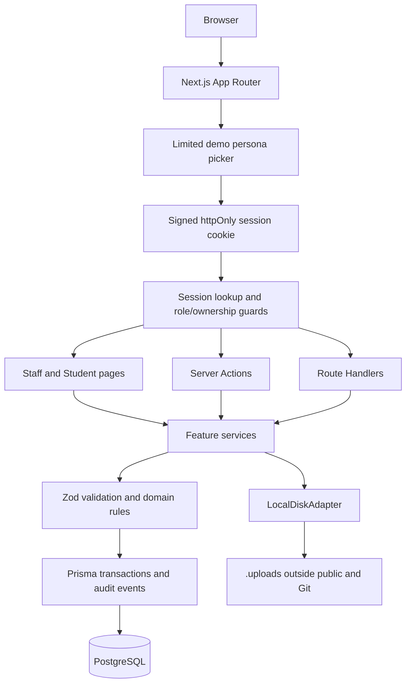

# SMS Registry: Architecture and Delivery Plan (v4)

This is the authoritative implementation plan. It supersedes the earlier abbreviated planning board. `IMPLEMENTATION_PLAN.md` is the live checkbox board; this document records the fixed architecture, scope decisions, rules, API contract, data model, seed coverage, and test gates that the board must implement.

## Product boundary and fixed defaults

Build a real-database Registry module for the assessed workflows only: enrolment, fees, submissions, and results. Complete the required workflow and correctness tests before stretch work.

| Decision | Fixed default |
|---|---|
| Identity | Limited demo personas and a server-verified demo session; no real credentials. |
| Currency | GBP application-wide. |
| Organisation time zone | `Europe/London`, set through `ORGANIZATION_TIMEZONE`. |
| Upload cap | 4 MB. |
| Repository/deployment | Private by default; no deployment target is assumed. Never commit the assessment PDF, `.env`, uploads, or credentials. |
| Overdue debt | Remains visible for deferred, withdrawn, and completed Students. Result publication requires explicit staff confirmation, is allowed, and is audited. |
| Persona picker | Only designated seeded demo personas; never a searchable directory of all Students. |

## Final architecture

Use Next.js App Router, TypeScript strict mode, Tailwind, Zod, Prisma, PostgreSQL, Vitest, npm, and a committed exact `package-lock.json`. Stable releases only: run `npm view prisma dist-tags` before initial installation and do not select a release candidate. Prisma setup follows the installed version, including Prisma 7 driver/configuration requirements.

### Layering and module responsibilities

| Layer | Responsibility | Prohibited shortcut |
|---|---|---|
| Pages/components | Present server-fetched state and accessible full-page forms. | Client-only mock state as a persistence layer. |
| Session/guards | Resolve JWT subject to current User/Student state in PostgreSQL on every protected request. | Trusting a UI role toggle. |
| Server Actions/Route Handlers | Authorize, parse input, call feature services, revalidate/return a standard envelope. | Direct unvalidated mutations that bypass services. |
| Feature services | Enforce business invariants, lock when needed, group mutation plus audit record transactionally. | Duplicating rules differently per page/API. |
| Prisma/PostgreSQL | Constraints, unique keys, transaction durability, queries. | Stored balances or client-calculated authority. |
| Storage adapter | Private UUID-keyed document persistence. | `public/` uploads or original-name storage keys. |

## Demo session, authorization, and cookie contract

- `/` lists two seeded Staff personas and a deliberately limited set of seeded Student demo personas.
- `User.isDemoPersona` controls both visibility and acceptance by the demo-session endpoint. Enrolment creates a linked Student User but never makes it a public demo persona.
- `signInAs(userId)` signs an eight-hour HS256 JWT using `jose`; the cookie carries only `sub`.
- `getSession()` verifies the token and then loads role, linked Student, and Student status from PostgreSQL.
- Guards are `requireStaff()`, `requireStudent()`, and `requireOwnStudent(studentId)`. Every Server Action, Route Handler, and protected page invokes a guard. `proxy.ts` may redirect but is never the authorization boundary.
- `POST /api/session` and `DELETE /api/session` exist only when `ENABLE_DEMO_SESSION=true`.
- The application header identifies the selected demo name and role and provides a persona-switch link.

Cookie attributes are `httpOnly`, `sameSite=lax`, `path=/`, eight-hour expiry, and a `secure` flag determined by `COOKIE_SECURE`:

| Setting | Behaviour |
|---|---|
| `true` | Always sends `Secure`. Use when an HTTPS proxy cannot forward protocol headers. |
| `false` | Never sends `Secure`; useful only for explicit local HTTP testing. |
| `auto` (default) | Trust first `X-Forwarded-Proto`, otherwise request origin/protocol. Never infer from `NODE_ENV`. |

`.env.example` includes a functional development-only secret of at least 32 characters, `ENABLE_DEMO_SESSION=true`, and `COOKIE_SECURE=auto`. Validation rejects only secrets shorter than 32 characters. A clean clone must sign in under both `npm run dev` and `npm run build && npm run start` at `http://localhost`.

## Security and upload baseline

Global `next.config` headers:

- `X-Content-Type-Options: nosniff`
- `X-Frame-Options: DENY`
- `Referrer-Policy: strict-origin-when-cross-origin`

`StorageAdapter` exposes `put`, `getStream`, and `delete`; this scope implements `LocalDiskAdapter` only. Files live in `UPLOAD_DIR` (default `./.uploads`), outside `public/` and Git. Multipart Node Route Handlers—not Server Actions—accept uploads.

Validate all documents before storage:

- size is 1 byte through `MAX_UPLOAD_MB` (maximum supported configuration: 4 MB);
- PDF has `.pdf`, declared `application/pdf`, and `%PDF-` signature;
- DOCX has `.docx`, the correct declared MIME, ZIP signature, and `word/document.xml`;
- ZIP constants are `MAX_ZIP_ENTRIES = 1000` and `MAX_DOCX_DECLARED_UNCOMPRESSED_BYTES = 50 * 1024 * 1024`;
- reject absolute paths (including drive paths), `..` segments, and backslash names, excessive entry count, or excessive declared uncompressed size.

Use UUID storage keys. Delete the stored file if its post-upload database transaction fails. Download only after Staff/ownership verification, stream with a sanitized attachment filename, `nosniff`, and `Cache-Control: private, no-store`.

## UI routes and workflow design

| Route | Behaviour |
|---|---|
| `/` | Limited seeded persona picker. |
| `/staff/dashboard` | Prioritised work queue: overdue accounts, open assessments, draft/withheld results; KPIs are secondary. |
| `/staff/students` | URL-backed case-insensitive name/ID search; programme, status, year filters; stable pagination of 20. |
| `/staff/students/new` | Enrolment with field errors, ID preview, duplicate warning, and fee-rule validation. |
| `/staff/students/[code]` | Overview, finance ledger, academic activity, audit timeline. |
| `/staff/students/[code]/edit` | Controlled edits with status-transition reason field. |
| `/staff/settings/programmes` | Minimal Programme, Module, and fee-rule administration. |
| `/staff/assessments` and `/staff/assessments/[id]` | Create/list, worklist, revision count, late state, download, deadline edit, close/reopen. |
| `/staff/results` | Assessment grade grid, classification preview, draft/withhold/publish/retract. |
| `/student/home` | Personal balance/due date/overdue notice/open work/published-result count. |
| `/student/assessments` | Upload/resubmit, deadline, revision state, and late indication. |
| `/student/results` | Only published results. |

Use full-page forms. Confirmation dialogs are restricted to payment void, publishing, and retraction. Validation retains input where possible, identifies fields, and provides a concise announced error summary.

### Grading grid membership

The grid is the deduplicated union of:

1. Currently eligible Students: `ENROLLED`, in the assessment module's Programme and academic year.
2. Students with an existing submission for the assessment.
3. Students with an existing result for the assessment.

Staff may grade every member. A withdrawn Student who submitted before withdrawal remains gradeable and a non-submitter displays `Not submitted`.

## Data model and database invariants

| Model | Responsibility/invariant |
|---|---|
| `User` | Name, role, optional unique `studentId`, `isDemoPersona`; no credentials. |
| `Student` | Immutable Student ID, normalized unique email, DOB, Programme, year, status/reason; indexed by programme/year/status. |
| `StudentIdCounter` | Transactional academic-year counter producing `SMS-YYYY-NNNN`, widening after 9999. |
| `Programme` / `Module` | Programme catalogue and modules; a Module determines an assessment's Programme. |
| `ProgrammeFeeRule` | One amount/due date per Programme/year; currency is application-wide. |
| `FeeAssignment` | One fee snapshot per Student; immutable except a permitted pre-activity re-snapshot, performed in one audited transaction. |
| `Payment` | Assignment, positive amount, date, normalized unique reference, active/void state and void metadata; indexed by assignment/status. |
| `FeeAdjustment` | Append-only non-zero signed amount, reason, actor, timestamp. |
| `Assessment` | Title, Module, academic year, UTC deadline, optional `closedAt`, creator. |
| `Submission` / `SubmissionRevision` | One parent per Student/assessment; immutable revisions carrying stored late state. |
| `Result` | Student/assessment pair, 0–100 grade, visibility state, reason, publisher metadata, optimistic-lock version. |
| `AuditEvent` | Actor, action, entity type/ID, timestamp, structured mutation metadata. |

Migration checks are mandatory:

- `Payment.amountMinor > 0`
- `FeeAdjustment.amountMinor <> 0`
- `Result.grade >= 0 AND Result.grade <= 100`

## Authoritative domain rules

### Students

- Academic year follows `YYYY/YY`; Student ID uses its first four digits.
- Enrolment is a single transaction: Student, linked Student User, Fee Assignment snapshot, and audit event. It fails if the Programme/year has no fee rule.
- Email is trimmed/lowercased. DOB is in the past. Matching normalized name + DOB yields a confirmable duplicate warning.
- Transitions: `ENROLLED → DEFERRED | WITHDRAWN | COMPLETED`; `DEFERRED → ENROLLED | WITHDRAWN`; `WITHDRAWN` and `COMPLETED` are terminal.
- Deferred/withdrawn transitions require a maximum-500-character reason.
- Programme/year changes are possible only with no payments, adjustments, submissions, or results. The old Fee Assignment is replaced by a matching snapshot in the same audit transaction. No other assignment mutation is permitted.

### Fees

- Derived balance: assigned fee + adjustments − active payments. Never store a balance column.
- Overdue: positive balance and organisation-local date after due date; due today is not overdue.
- Dashboard queue contains days overdue, balance, due date, and Student status; inactive Students retain debt visibility.
- Payment is positive, no greater than current outstanding amount, dated today or earlier, and has a unique normalized reference.
- Payment creation locks the assignment row inside its transaction before balance calculation. Payments are never edited/deleted; voiding requires reason and audit event.
- Adjustments require a reason, lock the assignment, and cannot make the balance negative.

### Assessments and submissions

- An assessment needs title, Module, academic year, deadline; it is open when `closedAt` is null.
- A first submission is accepted while open even after deadline; its late state is stored at creation.
- Resubmission is accepted only while open and at/before deadline. Only currently enrolled eligible Students can submit.
- Deadline edits, close, and reopen are audited. Existing late flags never change retroactively.

### Results

- Classification is pure: `0–39 Fail`, `40–59 Pass`, `60–69 Merit`, `70–100 Distinction`.
- State transitions: `DRAFT → PUBLISHED | WITHHELD`, `WITHHELD → PUBLISHED`, `PUBLISHED → WITHHELD`.
- Withhold/retract requires a reason. A published grade must be withheld before it can be edited/re-published.
- Every update must use the expected version in the database update predicate; stale writes return `409`.
- An overdue balance triggers a visible warning and an explicit audit-recorded publish override, not a block.
- Student result reads always filter own `studentId` and `PUBLISHED`; draft/withheld data is indistinguishable from no result.

## API contract

All APIs return `{ data }` or `{ error: { code, message, fieldErrors? } }`. Use `400`, `401`, `403`, `404`, `409`, `422`, and `500` consistently.

| Endpoint | Access and purpose |
|---|---|
| `GET/POST /api/students`; `GET/PATCH /api/students/[studentCode]` | Staff search, enrolment, detail, controlled edit. |
| `GET/POST /api/students/[studentCode]/payments`; `POST /api/payments/[paymentId]/void` | Staff ledger, payment, and void. |
| `GET/POST/PATCH /api/programmes`, `/api/modules`, `/api/fee-rules` | Staff catalogue administration. |
| `GET/POST /api/assessments`; `GET/PATCH /api/assessments/[assessmentId]` | Staff assessment lifecycle. |
| `GET/POST /api/assessments/[assessmentId]/submissions`; `GET /api/submissions/[revisionId]/download` | Upload/list and authorised download. |
| `GET /api/me/assessments`; `GET /api/me/results` | Student-own projections only. |
| `GET/POST /api/results`; `PATCH /api/results/[resultId]` | Staff grid and result lifecycle. |
| `GET /api/finance/overdue` | Staff overdue queue. |
| `POST/DELETE /api/session` | Demo-only session helper. |

## Seed scenarios

`prisma/seed.ts` must be deterministic relative to run date and create two Staff users, limited demo Students, two Programmes, three Modules, rules, assessments, sample grades, and valid PDF/DOCX fixtures in `.uploads`.

- fully paid enrolled Student with published Distinction;
- overdue Student with withheld result;
- future-due Student;
- deferred Student with balance/reason;
- withdrawn Student who submitted before withdrawal and remains gradeable;
- late first submission with draft grade;
- on-time resubmission with two revisions and published Merit;
- completed prior-year Student with published Fail;
- classification boundaries 39, 40, 59, 60, 69, 70;
- voided payment and adjustment;
- past-deadline open, future-deadline, and closed assessments;
- at least one demo Student for upload, allowed resubmission, late display, home balance, and published-result view.

`db:reset` rejects non-local hosts. Tests use `TEST_DATABASE_URL` only.

## Seven-day delivery sequence and cut order

| Day | Work | Gate |
|---|---|---|
| 1 | Scaffold; exact lock; env; migrations/checks; README skeleton; session/guards; picker; shell; docs. | Fresh clone signs in through dev and production HTTP localhost. |
| 2 | Catalogue, enrolment, ID, search/filter, detail/edit, status transitions. | Student-rule tests pass. |
| 3 | Fee snapshots, payments, voids/adjustments, balance, overdue queue, race tests. | Finance tests pass. |
| 4 | Assessment, eligibility, upload/download, revisions, late state, Student submit/resubmit view. | Submission tests pass. |
| 5 | Grade grid, classification, result lifecycle, Student home/results, seeded feature coverage. | Result and projection tests pass. |
| 6 | API/error/empty/loading states, accessibility pass, seeds, docs; optional smoke E2E. | Full local walkthrough passes. |
| 7 | Buffer: fresh clone, fixes, secrets/docs review; no features. | Repeat both HTTP sign-in checks. |

If time slips, cut in this order: bulk publish, adjustments UI, Playwright smoke, axe, CI, CSV. Never cut the staff assessment detail page, Student pages, Tier 1 tests, README/Decisions/AI Log.

## Test plan

### Tier 1 — required

- Classification boundaries, ID widening, assignment immutability/re-snapshot, date/overdue boundaries, money parsing, document validation, crafted ZIP metadata, late/resubmission logic.
- Atomic enrolment/rollback and concurrent Student ID issuance.
- Parallel-payment assignment-row lock proving no overpayment.
- Duplicate payment reference, void recalculation, fee snapshot preservation, adjustment constraint.
- Status-transition matrix and blocked programme/year changes after activity.
- Submission lifecycle: late first accepted, late resubmit/closed/non-enrolled rejected.
- Grading-grid union: eligible Student, withdrawn-after-submission Student, and historic-result Student all appear; Staff can grade each.
- Result state machine, database grade constraint, optimistic conflict, overdue override audit.
- Student cross-ownership is `404`; Staff-only endpoints `403`; no session `401`; draft/withheld values never appear in Student services or routes.
- Clean-clone cookie tests in both local HTTP runtime modes.

### Tier 2 — should

- Route-handler envelope/status tests.
- One Playwright smoke: Staff enrols, records payment, sees overdue queue; Student submits and sees only published results.

### Tier 3 — could

- axe scan of persona picker, dashboard, Student list, Student home.
- CI for lint/typecheck/tests/build.
- Formula-neutralised filtered CSV export with audit event.

## Continuity files and workspace policy

- `AGENTS.md`: constraints, current milestone, mandatory commands, read order.
- `Docs/plan/IMPLEMENTATION_PLAN.md`: live delivery board.
- This document: final architecture and full plan.
- `Docs/DECISIONS.md`: decision/rationale/rejected option/consequence.
- `Docs/AI_LOG.md`: factual milestone record; human reviewer corrects it before submission.
- `README.md`: setup, env, scripts, demo personas, edge cases, API examples, tests, architecture, limitations, and AI usage.

All development runs in WSL at `/mnt/d/Projects/SMS`; source and Git remain on `D:` for IDE visibility. `.venv` is for Python support tools. Docker PostgreSQL uses Docker-managed Linux volumes, never a repository directory.
