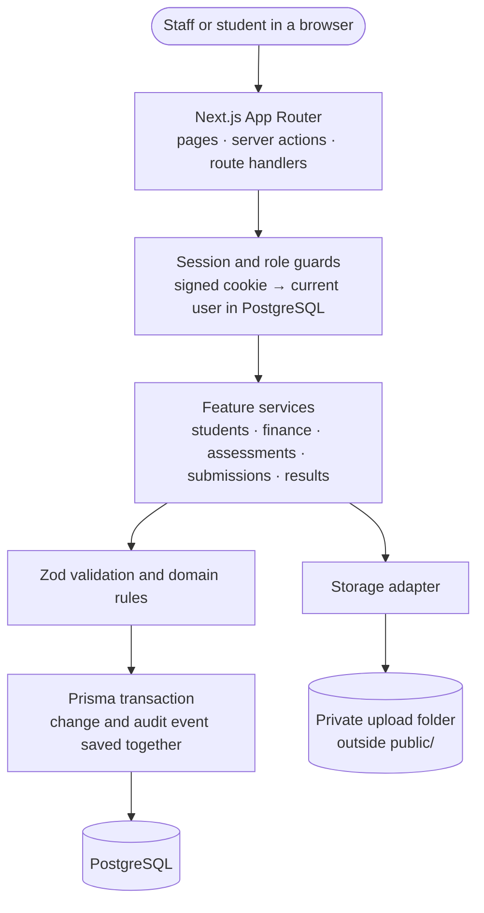

# SMS Registry

A Registry module for a Student Management System: **enrolment, fees and payments, assessment submissions, and controlled results publishing**, built with Next.js, PostgreSQL and Prisma.

It was built around the four workflows a Registry Administrator uses every day, with particular care for the situations that make registry work hard: overdue fees, late submissions, and results that must be withheld.

**Contents:** [Features](#features) · [Tech stack](#tech-stack) · [Architecture](#architecture) · [Getting started](#getting-started) · [Try it](#try-it) · [Configuration](#configuration) · [Scripts](#scripts) · [Testing](#testing) · [Project structure](#project-structure) · [Rules and edge cases](#rules-and-edge-cases) · [API](#api) · [Security](#security) · [Limitations](#limitations-and-next-steps) · [How AI was used](#how-ai-was-used) · [Troubleshooting](#troubleshooting)

## Features

| Workflow | What it does |
|---|---|
| **Student enrolment** | Creates students with an auto-generated ID (`SMS-2026-0001`), programme, academic year and status (Enrolled, Deferred, Withdrawn, Completed). Search by name or ID and filter by programme, year and status. Status changes require a reason for deferral and withdrawal. |
| **Fees and payments** | Each student gets a fee based on their programme, frozen at enrolment. Payments record an amount, date and unique reference. The outstanding balance is always calculated from the ledger, never stored. Staff can void a payment (with a reason) or apply an adjustment. The dashboard lists overdue accounts, including deferred and withdrawn students. |
| **Assessment submissions** | Staff create assessments with a module and deadline. Students upload a PDF or DOCX (up to 4 MB). Each student has one submission per assessment, with a full revision history. Resubmission is allowed until the deadline; a first submission after the deadline is accepted and clearly marked late. Staff can close and reopen an assessment. |
| **Marksheet and results** | Staff grade from 0 to 100 and the classification (Fail, Pass, Merit, Distinction) is applied automatically. Results can be published, withheld or retracted, each with a recorded reason where needed. Students only ever see published results. |

Behind all four: staff and student roles enforced on the server, an audit trail for every change, and an interface built with keyboard and screen-reader users in mind.

## Tech stack

| Area | Choice |
|---|---|
| Framework | Next.js 16 (App Router), React 19, TypeScript |
| Database | PostgreSQL with Prisma ORM 7 |
| Styling | Tailwind CSS 4 with shadcn-style components |
| Validation | Zod |
| Sessions | Signed, `httpOnly` JWT cookie (`jose`) |
| Testing | Vitest (unit and integration), Playwright with axe (browser and accessibility) |

## Architecture



Every page, server action and API route checks who is signed in and what they are allowed to see before touching data. Business rules live in the feature services, so the web pages and the JSON API behave identically. The complete design (data model, rules, API contract, security, testing) is in [`Docs/ARCHITECTURE.md`](Docs/ARCHITECTURE.md).

## Getting started

### Prerequisites

- **Node.js 20.19 or newer** (24 LTS recommended; an `.nvmrc` is included) and npm
- **PostgreSQL 14 or newer.** Docker Compose is the quickest way to get one, but any reachable database works.

### Setup

```bash
git clone https://github.com/ImamH0ssain/SMS.git
cd <repository-folder>
cp .env.example .env        # Windows PowerShell: Copy-Item .env.example .env
docker compose up -d        # starts PostgreSQL; skip if you have your own database
npm ci
npm run setup
```

`npm run setup` generates the Prisma client, applies the database migrations and loads the demo data. The defaults in `.env.example` match the Docker Compose database, so nothing needs editing for a local run.

To use your own PostgreSQL server instead of Docker, set `DATABASE_URL` in `.env` before running `npm run setup`.

### Run in development

```bash
npm run dev
```

Open <http://localhost:3000>.

### Run a production build

```bash
npm run build && npm run start
```

This also serves <http://localhost:3000>. The production build is optimised and behaves like a real deployment, so it is worth using for a final check. Stop the development server first, since both use port 3000, or choose another port with `npm run start -- -p 3100`.

Both modes serve plain HTTP, which is expected. The session cookie is only marked `Secure` when the request itself arrived over HTTPS (`COOKIE_SECURE=auto`), so signing in works over `http://localhost` in either mode.

## Try it

There are no passwords. The home page offers a small set of seeded demo accounts; choosing one starts an eight-hour session. Every page and action still checks the role and ownership on the server, so students cannot reach staff pages or other students' data.

| Account | Role and status | What to look at |
|---|---|---|
| Amelia Reid, Marcus Cole | Registry staff | The full staff workspace. Marcus is a second staff user, so the audit trail shows different actors. |
| Amina Rahman (`SMS-2026-0001`) | Enrolled | A published result. |
| Ben Carter (`SMS-2026-0002`) | Enrolled, part-paid | An overdue balance, a submission, and a result that is withheld (academic integrity review) and therefore invisible to him. |
| Clara Hayes (`SMS-2026-0003`) | Enrolled, Business programme | A closed assessment with a published result. |
| Ella Wright (`SMS-2026-0005`) | Withdrawn | A late submission to Algorithms coursework, and a draft result she cannot see. |
| Farah Khan (`SMS-2025-0001`) | Completed, previous year | A historic result and last year's fee. |
| Gita Singh (`SMS-2026-0006`) | Enrolled | A resubmission history of two revisions (the second is a DOCX). |
| Hugo Patel (`SMS-2026-0007`) | Enrolled | No submissions yet, so a good account for trying a first upload. |
| Isla Moore (`SMS-2026-0008`) | Enrolled | A published result with no submission, and an overdue balance banner. |

Dev Shah (`SMS-2026-0004`, deferred) is not a sign-in account, but staff can find him under **Students**: he has a voided payment and a fee adjustment.

The demo data is generated relative to the day you run `npm run setup`, so the overdue, late and open-assessment situations are always present.

### A five-minute tour

1. **As Amelia (staff)**, open the **Dashboard**. The overdue queue includes deferred and withdrawn students, so debt stays visible after someone leaves.
2. Open **Students → Ben Carter**. Review the balance, the payment ledger and the audit timeline. Record a payment, try to overpay (it is rejected), then void a payment.
3. Open **Assessments → Algorithms coursework**. Ella's late submission is flagged. Try closing the assessment or changing the deadline.
4. Open **Results** and choose **Programming project**. The grid includes students who have since withdrawn or never submitted. Try publishing Ben's withheld result: because his balance is overdue, you are asked to confirm, and the confirmation is recorded in the audit trail.
5. **Switch persona** (top right) to **Gita Singh** and open **My assessments**: revisions are listed, and replacing the file after the deadline is blocked.
6. Switch to **Ben Carter** and open **My results**: the withheld result does not appear anywhere.

## Configuration

Settings live in `.env` (copy `.env.example`). They are validated when the application starts.

| Variable | Purpose | Default in `.env.example` |
|---|---|---|
| `DATABASE_URL` | PostgreSQL connection string for the application | Docker Compose database on port 5432 |
| `TEST_DATABASE_URL` | Separate database used only by integration tests | Docker Compose test database on port 5433 |
| `SESSION_SECRET` | Signs session cookies (at least 32 characters). Replace it for any shared deployment. | Development-only value |
| `ENABLE_DEMO_SESSION` | Enables the demo account picker and `POST /api/session` | `true` |
| `COOKIE_SECURE` | `auto` follows the request protocol; `true` and `false` force the behaviour | `auto` |
| `ORGANIZATION_TIMEZONE` | Time zone used to display deadlines and to decide what "today" means | `Europe/London` |
| `APP_CURRENCY` | Application-wide currency | `GBP` |
| `UPLOAD_DIR` | Folder for uploaded documents (kept out of Git and outside `public/`) | `.uploads` |
| `MAX_UPLOAD_MB` | Largest accepted upload, from 1 to 4 | `4` |

## Scripts

| Command | What it does |
|---|---|
| `npm run dev` | Development server with hot reload |
| `npm run build` / `npm run start` | Production build and server |
| `npm run setup` | Generate the Prisma client, apply migrations, load demo data |
| `npm run db:seed` | Reload the demo data |
| `npm run db:reset` | Wipe and reseed the development database. It refuses to run against a non-local host. |
| `npm run db:migrate` | Create a new migration during development |
| `npm run db:deploy` | Apply existing migrations |
| `npm run lint` / `npm run typecheck` | Static checks |
| `npm run test` | Unit tests |
| `npm run test:integration` | Integration tests against PostgreSQL |
| `npm run test:e2e` / `npm run test:a11y` | Browser tests, and the axe accessibility scans on their own |

## Testing

```bash
npm run lint
npm run typecheck
npm run test               # 35 unit tests
npm run test:integration   # 26 tests against a real PostgreSQL database
```

**Integration tests** use the separate `TEST_DATABASE_URL` and never touch the development data. The Compose test database lives in memory, so it starts empty each time its container starts. Apply the schema first, then run the tests:

```bash
bash scripts/migrate-test-db.sh
npm run test:integration
```

**Browser tests** (four Playwright tests, including axe accessibility scans) run against the seeded development database. Install a browser once with `npx playwright install chromium`, then run `npm run test:e2e`. To use an existing Chrome instead, set `PLAYWRIGHT_CHROMIUM_EXECUTABLE` to its path.

What the tests cover:

- **Unit:** grade classification boundaries, student ID formatting and status transitions, money and overdue-date logic, late-submission and resubmission timing, file and ZIP validation.
- **Integration:** atomic enrolment and rollback, concurrent student ID issuance, parallel payments that must not overpay, duplicate payment references, voids, adjustments, fee snapshots, grading-grid membership, the result state machine and version conflicts, the full submission lifecycle (including cleanup of stored files when a transaction fails), database constraints, and the API's authentication, authorization and error responses.
- **Browser:** smoke paths for staff and student, with axe scans.

## Project structure

```text
prisma/            schema, migrations, demo-data seed
scripts/           database reset and test-database helper
src/app/           pages, server actions and API route handlers
  staff/           registry staff pages
  student/         student pages
  api/             JSON API
src/features/      business logic, one folder per area
  students/ finance/ assessments/ submissions/ results/
src/components/    shared interface components (ui/ holds the base primitives)
src/lib/           session, environment, errors, money, dates, storage
tests/             integration and browser tests
Docs/              architecture, decisions, AI log
```

## Rules and edge cases

The reasoning behind each choice is recorded in [`Docs/DECISIONS.md`](Docs/DECISIONS.md).

| Area | Behaviour |
|---|---|
| Enrolment | One transaction creates the student, their login, the fee snapshot and the audit event. If no fee rule exists for the programme and year, enrolment is refused with a clear message. A matching name and date of birth triggers a duplicate warning. |
| Student status | Enrolled can move to Deferred, Withdrawn or Completed; Deferred can return to Enrolled or move to Withdrawn; Withdrawn and Completed are final. A reason is required for deferral and withdrawal. Programme or year can only change before any payment, submission or result exists. |
| Balance | Fee at enrolment, plus adjustments, minus active payments. Overdue means a positive balance after the due date (due today is not overdue). Payments lock the fee record so two simultaneous payments cannot overpay it. |
| Submissions | A first submission is accepted while the assessment is open, even after the deadline, and is stored as late. A resubmission must arrive by the deadline. A closed assessment accepts nothing. Only enrolled students can submit. |
| Uploads | PDF or DOCX up to 4 MB. The file's content is checked, not just its name or declared type, and DOCX archives are inspected for unsafe entries. Files are stored privately under random names. |
| Grading grid | Shows eligible students plus anyone who already has a submission or result, so a student who withdrew after submitting can still be graded. |
| Results | Draft, withheld and published states. Withholding and retracting need a reason. A published grade must be withheld before it can be edited. Simultaneous edits are detected and the later one is rejected. Publishing for a student with an overdue balance needs an explicit, audited confirmation. |
| Student view | Students are only ever sent their own published results. Draft and withheld results are indistinguishable from having no result. |

## API

All endpoints return `{ "data": ... }` on success or `{ "error": { "code", "message", "fieldErrors" } }` on failure, using status codes 400, 401, 403, 404, 409, 422 and 500 consistently.

| Area | Endpoints |
|---|---|
| Students | `GET, POST /api/students` · `GET, PATCH /api/students/[studentCode]` |
| Finance | `GET, POST /api/students/[studentCode]/payments` · `POST /api/payments/[paymentId]/void` · `GET /api/finance/overdue` |
| Catalogue | `/api/programmes`, `/api/modules`, `/api/fee-rules` (collection and item routes) |
| Assessments | `GET, POST /api/assessments` · `GET, PATCH /api/assessments/[assessmentId]` |
| Submissions | `GET, POST /api/assessments/[assessmentId]/submissions` · `GET /api/submissions/[revisionId]/download` |
| Results | `GET, POST /api/results` · `PATCH /api/results/[resultId]` |
| Student projections | `GET /api/me/assessments` · `GET /api/me/results` |
| Utility | `GET /api/health` · `POST, DELETE /api/session` (demo sign-in, only while `ENABLE_DEMO_SESSION=true`) |

Example, using the cookie jar to stay signed in:

```bash
# 1. Find a seeded account id
docker compose exec postgres psql -U sms -d sms_registry \
  -c 'select id, name, role from "User" where "isDemoPersona"'

# 2. Sign in as that account
curl -c cookies.txt -X POST http://localhost:3000/api/session \
  -H 'content-type: application/json' -d '{"userId":"<id from step 1>"}'

# 3. Call protected endpoints
curl -b cookies.txt 'http://localhost:3000/api/students?q=Amina'
curl -b cookies.txt http://localhost:3000/api/finance/overdue
curl http://localhost:3000/api/health
```

## Security

- Authorization is enforced on the server for every page, action and API route. The cookie only identifies the user; their role and linked student record are looked up on each request.
- Uploads are validated by content, stored privately under random names outside `public/`, and only served after a role and ownership check, with `nosniff` and `no-store` headers.
- All responses carry `X-Content-Type-Options`, `X-Frame-Options` and `Referrer-Policy` headers.
- Money is stored as whole pennies, never as floating-point numbers, and database constraints back up the rules for payments, adjustments and grades.

## Limitations and next steps

This is an assessment build, and these gaps are deliberate:

- **Demo accounts instead of real sign-in.** Authentication is deliberately minimal. Real credentials or single sign-on would plug in behind the single `getSession()` function. Turn `ENABLE_DEMO_SESSION` off and set a strong `SESSION_SECRET` before any shared deployment.
- **Local file storage.** Uploads use a local-disk adapter. A production version would use object storage with malware scanning.
- **Not built:** payment gateway, refunds and instalments, per-student deadline extensions, bulk publishing, CSV export, programme and module editing screens, CI and a hosting pipeline.

## How AI was used

AI tools were used throughout: to draft the architecture and plan, to implement it, to run tests, and importantly, to review each other's work. I set the scope, made the product/architectural/system decisions, steered the agents according to my personal preference and when stuck or mistakes were made, and checked the results against the running application and a real database. Several AI claims turned out to be wrong and were caught on review; those are documented honestly.

- **Codex** (GPT 5.6 Terra) helped draft the plan, did the initial implementations and wrote the tests.
- **GitHub Copilot** (GPT 5.6 Luna) in VS Code continued the build, wrote some of the tests and made the review fixes.
- **Claude** (Sonnet 5.5) reviewed the plan against the assessment requirements, challenged the code and the agents' status reports, and drew the early wireframes.
- **Claude** (Opus 4.6) in Antigravity produced read-only audits of the codebase as a second opinion.

The full account, including what each tool got wrong and how it was caught, is in [`Docs/AI_LOG.md`](Docs/AI_LOG.md).

## Troubleshooting

| Problem | Fix |
|---|---|
| Port 3000 is already in use | Stop the other server, or run `npm run start -- -p 3100` (production) or `npx next dev -p 3100` (development). |
| `ECONNREFUSED` or a database error | Make sure PostgreSQL is running (`docker compose ps`) and that `DATABASE_URL` in `.env` is correct. |
| Browser on Windows cannot open the app running in WSL | Try `http://127.0.0.1:3000` instead of `localhost`. |
| Signed out unexpectedly after resetting the database | Demo sessions refer to database users; pick an account again on the home page. |
| `npm ci` cannot generate the Prisma client | The first install needs network access to download Prisma's tooling. Re-run once you are online. |
| Integration tests fail with a missing-table error | The test database is empty; run `bash scripts/migrate-test-db.sh` first. |

## More documentation

- [`Docs/ARCHITECTURE.md`](Docs/ARCHITECTURE.md): the complete design
- [`Docs/DECISIONS.md`](Docs/DECISIONS.md): product decisions and the reasoning behind them
- [`Docs/AI_LOG.md`](Docs/AI_LOG.md): how AI was used, and how its output was verified
- [`AGENTS.md`](AGENTS.md): working guide for contributors and coding agents
